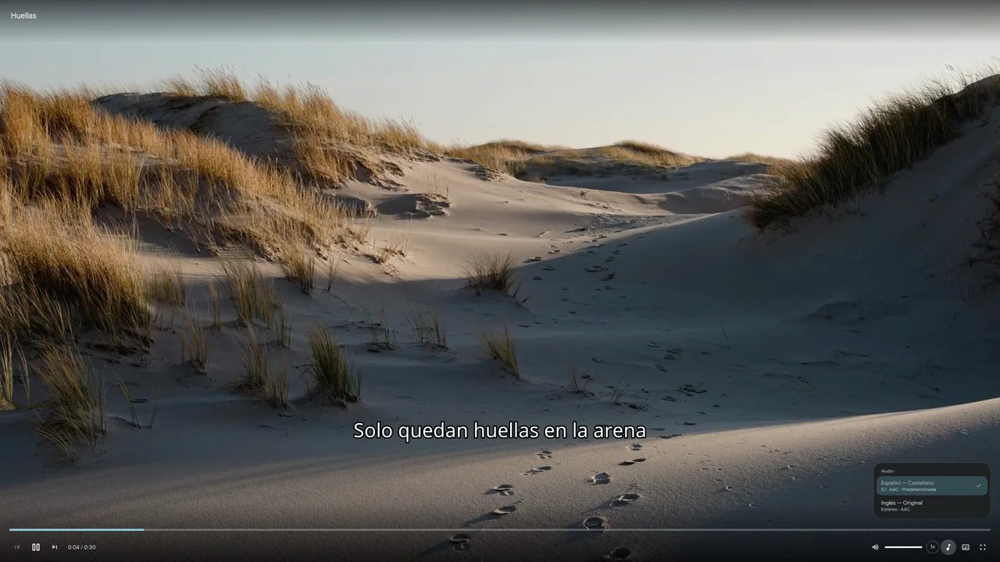

<h1 align="center">Veo</h1>

<p align="center"><a href="./README.md">English</a> · <strong>Español</strong></p>

<p align="center">
El reproductor de vídeo de <a href="https://github.com/iMacnucintosh/lunele-shell">Lunele</a>: pantalla completa, controles mínimos que se apartan solos, y las pistas de audio y subtítulos que traen tus archivos (los MKV suelen llevar varias).
</p>

<p align="center"></p>

Usa [libmpv](https://mpv.io), así que reproduce prácticamente cualquier formato, con decodificación por hardware y subtítulos ASS con su estilo.

## Funciones

- **Pantalla completa** al abrir un vídeo (`F`, `F11` o doble clic para alternar). Los controles y el puntero se esconden a los 2,5 s sin mover el ratón; vuelven al moverlo.
- **Controles**: play/pausa, anterior/siguiente de la carpeta, barra de progreso (arrastrar; enseña el tiempo bajo el puntero), volumen propio (rueda, flechas ↑↓, `M` silencia; se recuerda entre sesiones), velocidad (0,5×–2×), pistas de audio, subtítulos y pantalla completa.
- **Audio**: cada pista con su idioma («Español», «Inglés»), título, canales (Estéreo, 5.1…) y códec. Prefiere el idioma del sistema y luego el inglés.
- **Subtítulos**: los del archivo, los que estén junto al vídeo con el mismo nombre (se cargan solos) o uno elegido con Seeker (SRT, ASS, VTT); también arrastrándolo a la ventana. Retraso ajustable (`Z`/`X`, ±0,1 s).
- **Continuar donde lo dejaste**: posición, pistas de audio y subtítulos, y retraso de cada vídeo. Lo visto hasta el final empieza de nuevo.
- **Siguiente de la carpeta** (los capítulos de una serie, en orden natural: 2 antes que 10): al terminar aparece «A continuación» y empieza solo en 6 s, salvo que lo canceles.
- **Abrir**: argumento, arrastrar a la ventana o `O` (selector de Seeker).

### Teclado

| Tecla | Acción |
| --- | --- |
| `Espacio`, `K` | Pausa / reproduce |
| `←` `→` | −10 s / +10 s (`Mayús`: un minuto) |
| `↑` `↓` | Volumen ±5 |
| `M` | Silenciar |
| `F`, `F11`, doble clic | Pantalla completa |
| `Esc` | Cierra un menú o sale de pantalla completa |
| `N` / `P` | Siguiente / anterior de la carpeta |
| `[` `]` / `Retroceso` | Velocidad −/+ 0,25 / normal |
| `A` / `S` | Siguiente pista de audio / de subtítulos |
| `Z` `X` | Retraso de subtítulos −/+ 0,1 s |
| `Inicio` | Al principio |
| `O`, `Ctrl+O` | Abrir |
| `Q`, `Ctrl+Q`, `Ctrl+W` | Salir |

## Instalación

Viene con Lunele: [su instalador](https://github.com/iMacnucintosh/lunele-shell/blob/main/README.es.md#instalación) lo instala y lo deja como reproductor de vídeo predeterminado. Por separado, en Arch Linux, añade el [repositorio de paquetes de Lunele](https://github.com/iMacnucintosh/lunele-packages) e instálalo con pacman:

```sh
sudo pacman -S veo-git
```

## Compilar desde el código

Necesita Qt 6 (`qt6-base`, `qt6-declarative`, `qt6-svg`, `qt6-wayland`) y `mpv` (libmpv).

```sh
git clone https://github.com/iMacnucintosh/veo
cd veo
qmake6 PREFIX=$HOME/.local
make -j$(nproc)
make install
```

La receta del paquete es `packaging/PKGBUILD` (`veo-git`).

## Integración con Lunele

- **Tema**: Veo lee `~/.config/veo/theme.json`, que la shell escribe con cada esquema de colores, y lo sigue en vivo, claro u oscuro. También sigue la velocidad de animación de la shell (`animScale` en ese fichero).
- **Ficheros**: binario `~/.local/bin/veo`, estado `~/.local/state/veo/`.

## Idiomas

El código está en inglés; `i18n/<idioma>.json` lo traduce (`VEO_LANG` fuerza uno). Hoy: español (`es`). `scripts/check-i18n.py` comprueba que no falte ni sobre ninguna cadena.

## Licencia

GPL-3.0-only, ver [LICENSE](LICENSE). Copyright (C) 2026 Manuel López Mallorquín. Créditos en [NOTICE](NOTICE).
