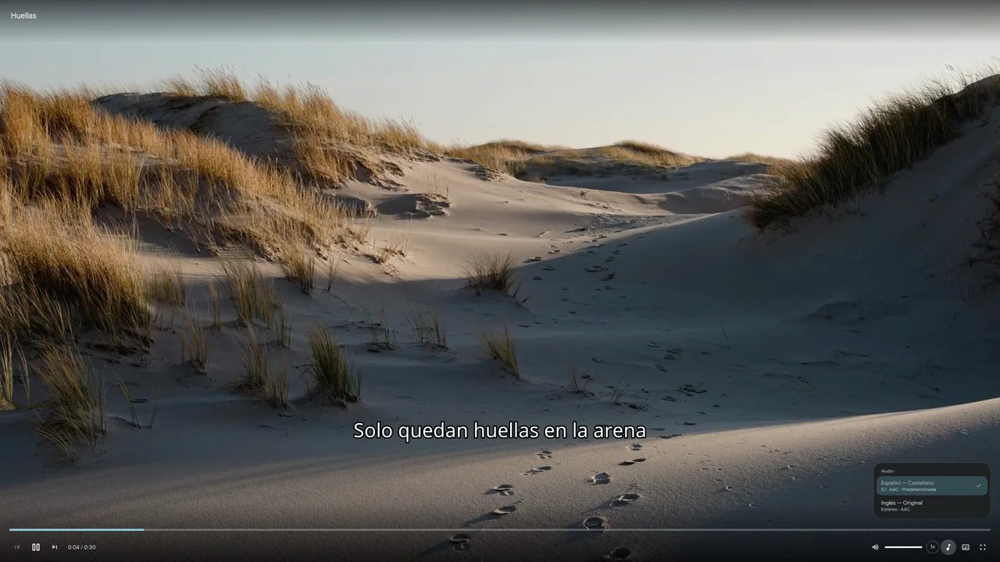

<h1 align="center">Veo</h1>

<p align="center"><strong>English</strong> · <a href="./README.es.md">Español</a></p>

<p align="center">
The video player of <a href="https://github.com/iMacnucintosh/lunele-shell">Lunele</a>: full screen, minimal controls that get out of the way, and the audio and subtitle tracks your files carry (MKVs often have several).
</p>

<p align="center"></p>

It uses [libmpv](https://mpv.io), so it plays almost any format, with hardware decoding and ASS subtitles in their own style.

## Features

- **Full screen** when you open a video (`F`, `F11` or a double click toggles it). The controls and the pointer hide after 2.5 s without moving the mouse and come back when you move it.
- **Controls**: play/pause, previous/next in the folder, a progress bar (drag it; it shows the time under the pointer), its own volume (wheel, `↑` `↓`, `M` mutes; remembered between sessions), speed (0.5×–2×), audio tracks, subtitles and full screen.
- **Audio**: each track with its language ("Spanish", "English"), title, channels (Stereo, 5.1…) and codec. It prefers the system language, then English.
- **Subtitles**: the ones in the file, the ones next to the video with the same name (loaded by themselves) or one you pick with Seeker (SRT, ASS, VTT); you can also drop one on the window. Adjustable delay (`Z`/`X`, ±0.1 s).
- **Resume where you left off**: position, audio and subtitle tracks and delay of each video. What you watched to the end starts again.
- **Next in the folder** (the episodes of a series, in natural order: 2 before 10): when one ends "Up next" appears and it starts by itself in 6 s, unless you cancel it.
- **Open**: an argument, dragging onto the window or `O` (Seeker's file picker).

### Keyboard

| Key | Action |
| --- | --- |
| `Space`, `K` | Pause / play |
| `←` `→` | −10 s / +10 s (`Shift`: one minute) |
| `↑` `↓` | Volume ±5 |
| `M` | Mute |
| `F`, `F11`, double click | Full screen |
| `Esc` | Close a menu or leave full screen |
| `N` / `P` | Next / previous in the folder |
| `[` `]` / `Backspace` | Speed −/+ 0.25 / normal |
| `A` / `S` | Next audio track / subtitle track |
| `Z` `X` | Subtitle delay −/+ 0.1 s |
| `Home` | To the start |
| `O`, `Ctrl+O` | Open |
| `Q`, `Ctrl+Q`, `Ctrl+W` | Quit |

## Install

It comes with Lunele: [its installer](https://github.com/iMacnucintosh/lunele-shell#installation) sets it up and makes it the default video player. On its own, on Arch Linux, add the [Lunele package repository](https://github.com/iMacnucintosh/lunele-packages) and install it with pacman:

```sh
sudo pacman -S veo-git
```

## Build from source

It needs Qt 6 (`qt6-base`, `qt6-declarative`, `qt6-svg`, `qt6-wayland`) and `mpv` (libmpv).

```sh
git clone https://github.com/iMacnucintosh/veo
cd veo
qmake6 PREFIX=$HOME/.local
make -j$(nproc)
make install
```

The package recipe is `packaging/PKGBUILD` (`veo-git`).

## Lunele integration

- **Theme**: Veo reads `~/.config/veo/theme.json`, which the shell writes with every colour scheme, and follows it live, light or dark. It also follows the shell's animation speed (`animScale` in that file).
- **Files**: binary `~/.local/bin/veo`, state `~/.local/state/veo/`.

## Languages

The code is in English; `i18n/<language>.json` translates it (`VEO_LANG` forces one). Today: Spanish (`es`). `scripts/check-i18n.py` checks that no string is missing or left over.

## License

GPL-3.0-only, see [LICENSE](LICENSE). Copyright (C) 2026 Manuel López Mallorquín. Credits in [NOTICE](NOTICE).
